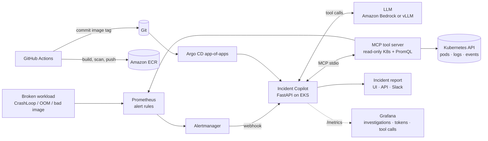

# Incident Copilot: AI Agent for Kubernetes Incidents on AWS (EKS + Bedrock + MCP)

When a Prometheus alert fires, Incident Copilot **investigates it like an on-call SRE would**. It lists unhealthy pods, reads the crashed container's logs, checks events, deployment status and metrics, and then writes a root-cause report with recommended fixes. It posts the report to its web UI and, optionally, to Slack.

The agent's tools are served through the **Model Context Protocol (MCP)**, the same standard Claude Desktop and IDEs use, so the tool server can be reused by any MCP client. It runs on **Amazon EKS** with **Amazon Bedrock**, or with a **self-hosted open-source model on vLLM**.



## What this project shows

| Area | What's implemented |
|---|---|
| **Agentic AI** | A tool-calling agent loop with a step budget. The model decides which tools to call, sees the results and writes a structured report (Summary, Evidence, Root cause, Next steps, Confidence) |
| **MCP** | An MCP server (`copilot/mcp_server.py`) exposing 5 read-only tools; the agent connects to it as an MCP client over stdio |
| **LLMs** | **Amazon Bedrock Converse API** (default: Amazon Nova Lite) or any **OpenAI-compatible** server: **vLLM** on a GPU node, or Ollama locally |
| **Safety guardrails** | Read-only Kubernetes RBAC, a namespace allow-list, **secret redaction** of logs before they reach the LLM, output truncation, de-duplication of repeated alerts, and at most 2 concurrent investigations |
| **Infrastructure as Code** | **Terraform**: VPC, EKS (optional GPU node group), ECR with scan-on-push, **IRSA** role limited to `bedrock:InvokeModel`, GitHub **OIDC** role limited to pushing to one ECR repo |
| **GitOps** | **Argo CD app-of-apps**: one `kubectl apply` creates the monitoring stack, the copilot and the demo workloads |
| **Observability** | Prometheus metrics (investigations, duration, tool calls, LLM latency, tokens, redactions), a Grafana dashboard and alert rules, including one that fires if the copilot itself starts failing |
| **CI/CD** | GitHub Actions: ruff, pytest (including an end-to-end MCP test), Docker build, **Trivy** scan, push to ECR, GitOps tag bump |

## Repository layout

```
incident-copilot-aws/
├── app/copilot/
│   ├── main.py          API: Alertmanager webhook, /investigate, /incidents, UI, /metrics
│   ├── agent.py         the tool-calling loop
│   ├── backends.py      Bedrock Converse + OpenAI-compatible (vLLM/Ollama) backends
│   ├── mcp_server.py    MCP server with the read-only tools
│   ├── mcp_client.py    starts the MCP server and exposes its tools to the agent
│   ├── k8s_tools.py     Kubernetes + Prometheus queries (and sample data for demos)
│   ├── alerts.py        Alertmanager payload parsing + prompts
│   └── redact.py        secret redaction
├── app/tests/           unit tests + MCP integration test
├── infra/terraform/     AWS infrastructure
├── deploy/helm/         Helm chart (RBAC, alert rules, Grafana dashboard)
├── deploy/argocd/       app-of-apps (monitoring + copilot + demo)
├── deploy/demo/         intentionally broken workloads
├── deploy/vllm/         optional self-hosted model on GPU
├── local/               free local demo (Docker Compose + Ollama)
└── scripts/             send a test alert
```

---

## Part 1: Run it locally for free (start here)

No AWS account and no Kubernetes cluster are needed. **Ollama** runs a small open-source model with tool calling, and `K8S_MODE=fake` makes the tools return realistic sample data from a broken `payments-api`.

**You need:** Docker Desktop.

```bash
git clone https://github.com/Ashrithvodnala/ashrith-portfolio.git
cd ashrith-portfolio/incident-copilot-aws
docker compose -f local/docker-compose.yml up --build
```
The first start downloads the model (about 2 GB). Then, in a second terminal:
```bash
./scripts/send-test-alert.sh
```
You'll see the agent's incident report in the terminal, and in the UI at **http://localhost:8000**. Notice that the sample log contains `password=hunter2` but the report never does, because it's redacted before the model sees it.

Run the tests:
```bash
cd app && pip install -r requirements-dev.txt && pytest -q
```

---

## Part 2: Deploy to AWS

> **Cost warning:** EKS (about $0.10/hour), two t3.large nodes and a NAT gateway cost roughly **$5–7 a day**. The optional GPU node adds about $1 an hour. Bedrock costs a few cents for this demo. Deploy, take screenshots, then `terraform destroy`.

**You need:** an AWS account with admin access, the [AWS CLI](https://docs.aws.amazon.com/cli/latest/userguide/getting-started-install.html) (`aws configure`), [Terraform](https://developer.hashicorp.com/terraform/install), [kubectl](https://kubernetes.io/docs/tasks/tools/).

### Step 1: Check Bedrock model access
In the AWS console, open **Amazon Bedrock → Model access** in your region and make sure **Amazon Nova Lite** (or the model you choose) is available to your account.

### Step 2: Create the infrastructure
```bash
cd incident-copilot-aws/infra/terraform
cp terraform.tfvars.example terraform.tfvars
terraform init
terraform plan
terraform apply          # about 15-20 minutes
$(terraform output -raw update_kubeconfig)
kubectl get nodes
```
If your account already has a GitHub OIDC provider, set `create_github_oidc_provider = false` in `terraform.tfvars`.

### Step 3: Set the app values
Copy `copilot_role_arn` from `terraform output` into `irsaRoleArn` in `deploy/helm/incident-copilot/values.yaml`, then commit and push.

### Step 4: Turn on CI/CD
In GitHub, open **Settings → Secrets and variables → Actions → Variables** and add:

| Variable | Value |
|---|---|
| `AWS_ROLE_ARN` | terraform output `github_actions_role_arn` |
| `AWS_REGION` | e.g. `us-east-1` |
| `ECR_REPOSITORY_URL` | terraform output `ecr_repository_url` |

Run the **incident-copilot-ci** workflow from the Actions tab. It builds, scans and pushes the image, then commits the new tag.

### Step 5: Install Argo CD and deploy everything
```bash
kubectl create namespace argocd
kubectl apply -n argocd -f https://raw.githubusercontent.com/argoproj/argo-cd/stable/manifests/install.yaml
kubectl apply -f ../../deploy/argocd/root-app.yaml
```
Argo CD now creates the monitoring stack, the copilot and the three broken demo apps. Within about 5 minutes alerts fire and investigations start.

```bash
kubectl -n copilot port-forward svc/incident-copilot 8000:80             # reports: http://localhost:8000
kubectl -n monitoring port-forward svc/monitoring-grafana 3000:80        # dashboard "Incident Copilot"
kubectl -n argocd port-forward svc/argocd-server 8080:443                # Argo CD
```
For passwords, see the OpsPilot README (same commands). **Take screenshots now** of the incident reports, the Grafana dashboard, the Argo CD app tree and the GitHub Actions run.

### Optional: use a self-hosted model with vLLM
1. Set `enable_gpu_nodes = true` in `terraform.tfvars` and run `terraform apply`.
2. Install the NVIDIA device plugin: `helm repo add nvdp https://nvidia.github.io/k8s-device-plugin && helm install nvdp nvdp/nvidia-device-plugin -n kube-system`.
3. `kubectl apply -f ../../deploy/vllm/vllm.yaml` and wait until the pod is ready.
4. Set `llm.provider: openai` in the Helm values and push. Argo CD switches the agent to your own model.

### Step 6: Tear everything down
```bash
kubectl delete -f ../../deploy/argocd/root-app.yaml   # removes load balancers/volumes created by apps
terraform destroy
```

---

## Design decisions (be ready to explain these)

- **Why MCP for the tools?** MCP is an open standard for connecting models to tools. Putting the Kubernetes tools behind an MCP server means the same tools work in this agent, in Claude Desktop or in an IDE. The agent code only knows the tool names and schemas, not the Kubernetes API.
- **How does the agent loop work?** The model gets the alert and the tool list. When it requests tools, the app runs them through MCP, redacts and truncates the output, and sends it back. After at most `MAX_STEPS` rounds it must write the final report. This is the standard "ReAct"-style loop, with a hard budget so costs and runtime stay bounded.
- **Why is it read-only?** An AI agent shouldn't change production by itself. RBAC allows only `get/list/watch`, the namespace allow-list limits where it can look, and the recommended fixes are for a human to apply.
- **How does the pod call Bedrock without access keys?** IRSA: EKS gives the pod a service-account token. AWS STS trusts the cluster's OIDC provider and returns temporary credentials for a role that can only invoke Bedrock models.
- **How does GitHub Actions push without access keys?** GitHub OIDC: the workflow gets a short-lived token, and AWS lets only `main` of this repository assume a role that can only push to this one ECR repository.
- **Why Bedrock and vLLM?** Bedrock is managed and pay-per-token, with nothing to operate. vLLM shows the other side: hosting an open-source model on your own GPU nodes, which matters when data can't leave the cluster or token volume is high. The same agent code works with both through two small backends.
- **Why de-duplicate alerts?** Alertmanager re-sends firing alerts. Without de-duplication, the same incident would be investigated (and paid for) repeatedly. Fingerprints are remembered for 10 minutes.
- **What would make it production-ready?** Persistent incident storage (e.g. DynamoDB), authentication on the UI, an evaluation set of past incidents to measure report quality, and posting reports to PagerDuty or a ticketing system.
